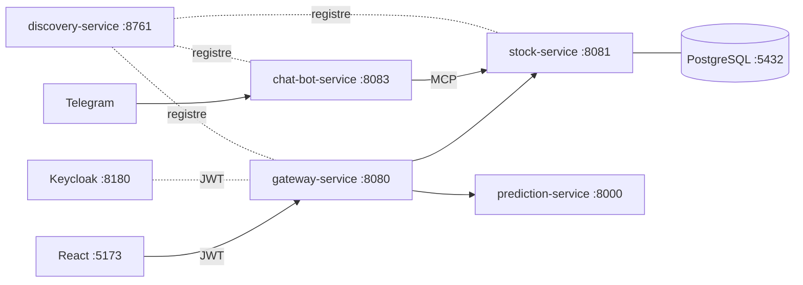

# ENSET – ADRIA : Système distribué de gestion des cotations boursières

Projet de test technique (Master SDIA) : microservices Spring Cloud, serveur MCP, agent IA (Spring AI + Telegram), frontend React, modèle de prédiction Python et sécurité Keycloak.

> Le README complet (architecture, endpoints, tests, captures) sera finalisé en Phase 13.

## Architecture (vue d'ensemble)



## Modules

| Module | Rôle | Port |
|---|---|---|
| `discovery-service` | Eureka Server | 8761 |
| `gateway-service` | Spring Cloud Gateway (reactive) | 8080 |
| `stock-service` | Gestion des cotations + MCP | 8081 |
| `chat-bot-service` | Agent IA Spring AI + Telegram | 8083 |
| `frontend` | React + TypeScript | 5173 |
| `prediction-service` | FastAPI + ML | 8000 |
| `devops` | Docker Compose, Keycloak, scripts | – |

## Technologies

Java 21, Maven, Spring Boot 3.5.16, Spring Cloud 2025.0.3, Spring AI 1.1.8, PostgreSQL, Keycloak, React + TypeScript, Python / FastAPI, Docker.

## Prérequis

JDK 21 (`JAVA_HOME` + PATH), Maven 3.9+, Git, Node.js, Python 3.12, Docker, Ollama.

## Compilation

```powershell
mvn clean verify
```

## Secrets

Aucun secret n'est versionné. Copier `.env.example` vers `.env` et le renseigner localement.
